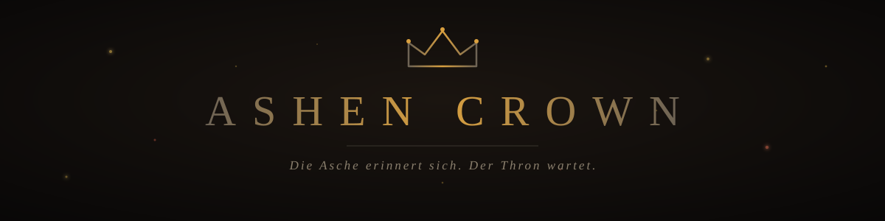
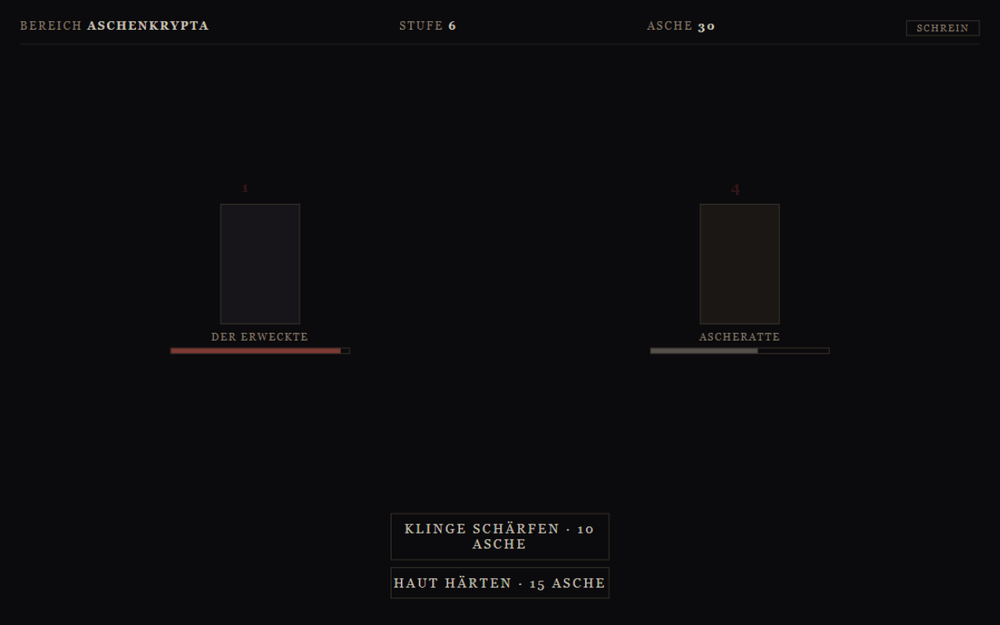
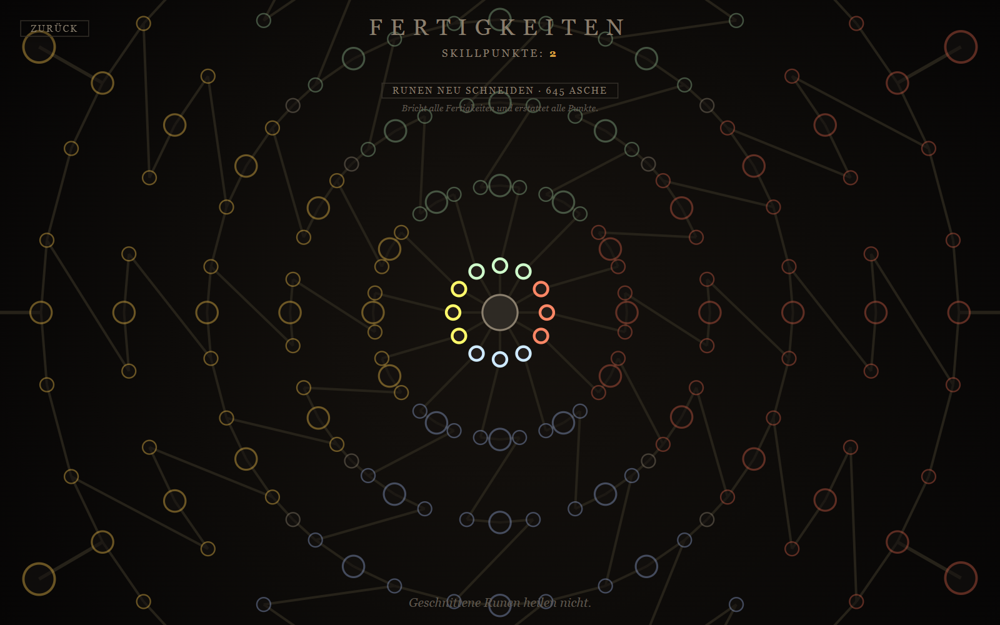
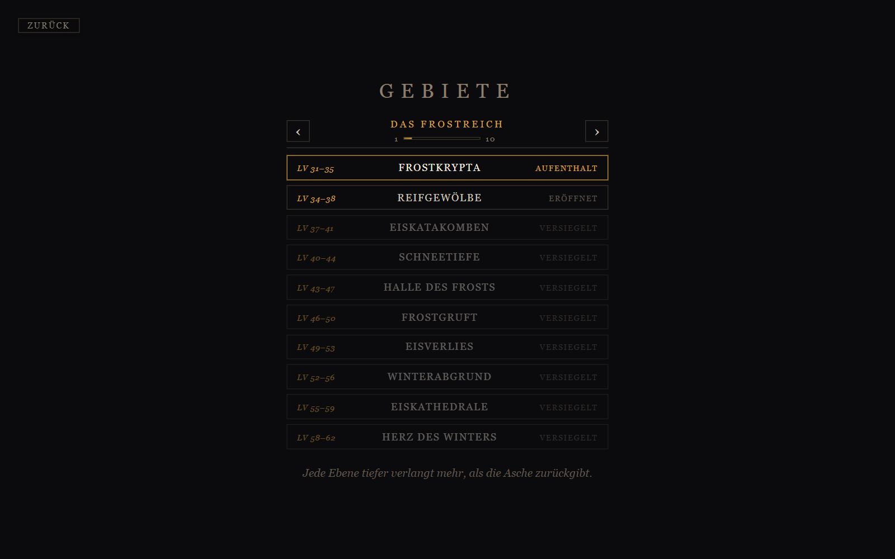

<div align="center">
  

  **Ashen Crown** ist ein inkrementelles Dark-Fantasy-RPG: Du erwachst in der Asche,
  kämpfst dich Gebiet für Gebiet durch **fünf Kontinente** — und formst dabei einen
  Helden, der ganz nach deinem Willen geformt ist.

  [](releases)
  [](https://vite.dev)
  [](https://tauri.app)
  [](https://pnpm.io)
  [](https://developer.mozilla.de/de/docs/Web/JavaScript)
  [](../../actions/workflows/ci.yml)
  [](LICENSE)

  *Web & Desktop — ohne Framework, ohne Server, mit Speicherstand im Browser.*

  **🧪 Aktuell: Closed Alpha (v0.18.4)** — Installer über die
  [Releases](releases), Updates installieren sich im Spiel von selbst.
</div>

---

## 🕯️ Das Spiel

Ashen Crown ist ein Idle-RPG: Der Kampf läuft von allein, die Entscheidungen triffst du.
Erlege Kreaturen, sammle Asche, schärfe Klinge und Haut, rüste Beute aus — und steige
Gebiet für Gebiet tiefer, bis dir am Ende der Leere die Aschenkrone selbst gegenübersteht.
Denn die Asche erinnert sich — an jedes Reich, das vor dir versuchte, ihr zu entkommen.

| Kampf | Fertigkeiten | Gebiete |
| :---: | :---: | :---: |
|  |  |  |

## ⚙️ Systeme, die ineinandergreifen

### ⚔️ Kampf & Zonen

- **Auto-Kampf & Zonen** — **5 Kontinente** mit je **10 Ebenen**, dahinter die
  endlosen **Aschentiefen**. Jedes Gebiet bringt sein eigenes Bestiarium aus drei
  Kreaturen mit — **150 Gegner insgesamt**, von der Ascheratte bis zur Aschenkrone.
  Pro Ebene wartet nach 30 Siegen ein Boss; sein Fall öffnet die Tür in die Tiefe.
  Jede Zone kämpft mit eigenem Temperament (*Flink* oder *Massiv*), Bosse verfallen
  unter 35 % Lebenskraft in **Wut** — und jeder Gegner trägt die Färbung seines
  Kontinents. Kämpfen ist Handwerk: **Gegner greifen gelegentlich daneben** (15 %),
  dein Held verfehlt auch (12 %), die Kritchance deckelt bei 75 %, und Rüstung
  mindert nie mehr als die Hälfte — mindestens 50 % jedes Schlags kommen durch.
- **Die Arena ist eine Bühne** — Sieben handgesetzte Silhouetten-Sprites
  (Diener, Bestie, Ritter, Kultist, Schatten, Koloss, Regent) kämpfen auf einer
  kontinentfarbenen Bühne mit Bodenschatten: Bosse tragen die goldene Krone,
  Eliten einen goldenen Randschimmer, Wut lässt die Augen aufflammen. Funken am
  Einschlag, der Hieb-Bogen und der Geist-Nachlauf auf den HP-Leisten machen
  jeden Treffer lesbar.
- **Der Gegner-Inspektor** — Hover auf den Gegner verrät Level, Schaden pro Schlag,
  Angriffstempo, Temperament und die Schadensminderung, die deine Rüstung gerade
  bewirkt. Und wenn es doch schiefgeht, nennt der **Todesrückblick** den Bezwinger
  mit Trefferzahl und Schadenssumme: Du weißt immer, warum du gestorben bist.
- **Der Schrein atmet — und zählt** — Im Feld regeneriert dein Held nie von selbst;
  nur das Rasten am Schrein heilt (2 % pro Sekunde), und wer aufbricht, nimmt seine
  Lebenskraft mit, wie sie ist. Stirbst du, erwachst du mit einem Viertel deiner
  Lebenskraft — und die Asche behält 15 % deines Vorrats als Zoll.
- **Erfahrung gibt es nur von Würdigen** — Gegner unter deinem Niveau tragen weniger
  bei, 20 Stufen darunter gar nichts. Und mancher Boss ist eine echte **Wand**:
  Dann heißt es zurück, Asche und Beute farmen, besser schmieden — und es ihm
  nochmal zeigen. Der Held wächst dabei mit: Er bleibt dauerhaft nur wenige Stufen
  unter seinen Gegnern.

### 🌳 Fertigkeitenbaum

**217 Knoten** im Path-of-Exile-Stil: vier Pfade (Krieg, Haut, Asche, Geist) mit
kleinen Passives, Notables und **12 Keystones mit Tradeoffs**. **12 Brücken**
verbinden die Pfade miteinander — für Misch-Builds, die es so kein zweites Mal gibt.
Der Baum **erwacht ab Stufe 20** — erst dann gibt es Runenpunkte, und seine Werte
sind bewusst gedämpft. Und er will Entscheidung: **Maximal zwei Pfade erwachen
gleichzeitig** — die übrigen versiegeln sich, bis ein Respec sie wieder öffnet.

### 🗡️ Loot & Inventar

- **7 Rüstungsslots, 5 Raritäten** (Gewöhnlich → Magisch → Selten → Episch →
  Legendär) über **35 Item-Basen** à la Diablo: Klinge bis Sense, Brustplatte bis
  Plattenharnisch — höhere Basen schalten per Itemlevel frei und prägen den
  Hauptwert. Jede Seltenheit kauft Affixplätze, jedes Stück **rollt seine Werte**
  — das perfekte Exemplar ist ein Fund, kein Rechenresultat (gedrückte Alt-Taste
  zeigt die Roll-Spannen).
- **Beute ist ein Ereignis** — Der erste Elite-Kill eines Gebiets garantiert ein
  Stück, der Boss kämpft mit 75 % Fundchance, normale Gegner bleiben das seltene
  Glück. Lifeleech gibt es ausschließlich auf epischen und legendären Waffen.
- **Komfort auf Wunsch** — **Auto-Tür** (nach dem Boss geht es von allein weiter),
  **Auto-Verkauf** (Beute unter einer gewählten Seltenheit wird beim Fund zu Asche),
  dazu Sortieren und „Bestes anlegen". Legendäre Stücke tragen eine goldene
  **Meisterschaft** — Prozentboni, die es sonst auf Gear nirgends gibt.

### 🏺 Die Werkstatt

Die Werkstatt macht Asche zu Macht: Ausrüstungsstufen **verstärken** (steile
Kostenkurve pro Stufe) oder **umschmieden** (Rarity-Upgrade mit Neuwurf, senkt das
Ilvl nie). Die goldene Meisterschaft lässt sich gegen viel Asche **neu schmieden**
— die Endgame-Jagd nach dem Perfekt-Wurf. Und im Helden-Screen können verteilte
**Statpunkte neu verteilt** werden: Alle Punkte zurück, nichts bleibt verbaut.
Alles skaliert mit der tiefsten errungenen Ebene.

### 🏆 Ruhm, Errungenschaften & Wissen

- **Errungenschaften & Ruhm** — **29 Auszeichnungen** aus Jagd, Stürzen, Spielzeit,
  Beute und Reich-Fortschritt zahlen **Ruhm**, eine Währung, die es nur durch
  Tun gibt. Im **Ruhm-Laden** kaufst du permanente Erleichterungen: **Beutelschein**
  (+Inventarplätze), **Zollerlass** (−Todeszoll), **Aschesegen** (+Asche-Ertrag),
  **Tiefenkunde** (+Offline-Fortschritt) und **Werkstatthandwerk** (−Werkstatt-
  Kosten). Der Laden kostet insgesamt mehr, als je an Ruhm existiert — Ruhm bleibt
  eine Entscheidung, keine Checkliste.
- **Bestiarium & Statistik** — **163 Kreaturen** in der Chronik-Schwester: erlegt
  entschleiert, unerlegt bleibt „???" versiegelt. Die Statistik-Seite zählt
  Spielzeit, Tode, Beute je Seltenheit und deinen tiefsten Erfolg — die Asche
  vergisst nicht.

### 🌌 Unter dem Thron: Die Aschentiefen

Hinter dem Sieg wartet das Endgame: prozedural tiefer werdende **Aschentiefen**
mit eigener Gegnerschaft. Der erste Boss jeder Tiefe hinterlässt garantiert ein
**Tiefenrelikt** — ein Legendärstück auf Tiefen-Itemlevel mit gesicherter Lifeleech
und **zwei Meisterschaften**. Die zweite Meisterschaft lässt sich für **2 Ruhm**
neu schmieden: günstig, unbegrenzt, die Jagd des Endgames.

### 🔁 Erneut erwachen: Der Thron

Nach dem ersten Kronensieg öffnet sich die Hub-Kachel **„Der Thron"** — dort,
wo die Krone ruht. Jeder abgeschlossene Lauf zahlt **Kronenasche**: 1 für die
gehobene Krone, +1 je volle 5 errungene Aschentiefen. Sie ist die zweite,
wiederkehrende Meta-Währung neben Ruhm — und sie wirkt nicht durchs Ausgeben:
**Jede erworbene Kronenasche segnet alle künftigen Läufe** mit +3 % Asche &
Erfahrung, lebenslang, unabhängig davon, was du investierst.

Ausgegeben wird sie im **Vermächtnis** auf sechs gestufte Titel (je 3 Stufen,
zusammen 36 Kronenasche — der Satz füllt sich über mehrere Läufe, die
Reihenfolge wählst du):

| Titel | Wirkung je Stufe |
| --- | --- |
| *Zweiter Atem* | +5 % Lebenskraft & Schaden auf den Helden-Grundwert |
| *Aschengeist* | +5 % Erfahrung |
| *Beutelspähler* | +5 % Asche-Ertrag |
| *Alter Pfad* | Erwache mit +2 freien Statpunkten |
| *Tiefenwissen* | +10 % Elite-/Boss-Fundchance |
| *Der Vorbereitete* | Erwache mit 25 Asche |

**Erneut erwachen** setzt den Lauf zurück — Zone & Gebiete, Held (Stufe, EP,
Statpunkte, Runen & Pfad-Bindung), Asche, Ausrüstung & Inventar. Was bleibt:
das ganze **Ruhm-Ökosystem**, **Kronenasche & Vermächtnis**, **Bestiarium,
Chronik & Statistik**. Der Thron zeigt vorher eine Verfällt/Bleibt-Vorschau
und will den Entschluss zweimal gehört haben — erst der zweite Klick vollzieht
das Erwachen. Die Kontinent-Annalen liest du dabei erneut; die Asche erinnert
sich an alles andere.

### 🌙 Chronik, Klang & Komfort

- **Chronik & Lore** — Die Asche erinnert sich: Intro-Erzählung beim Erwachen, eine
  Annale pro Kontinent beim ersten Betreten, ein Epitaph über jedem der **50
  bezwungenen Bosse** und Flüstertöne aus den Tiefen — alles gesammelt am Schrein.
- **Klang & Feedback** — Prozeduraler Sound aus der Web Audio API (keine Assets):
  Treffer, Krits, Bosse, Beute, Aufstiege, Enrage, dazu ein dunkler Ambient-Drone,
  der über Intensitäts-Layer mit Abstieg, Hub, Sieg und Prestige dichter wird —
  mit Reglern für Gesamt, Effekte und Musik. Schadenszahlen, Aufblitzen und Toasts
  lassen sich trennen.
- **Offline-Fortschritt** — Wer im Feld aufhört, kämpft bis zu **8 Stunden** ohne
  dich weiter (mit Tiefenkunde bis 20). An einer Boss-Wand weicht der simulierte
  Held aufs beste errungene Gebiet aus und farmt weiter — und meldet dir bei der
  Rückkehr, was er erlegt, gefunden und gelernt hat.
- **Spielstand mit Sicherheitsnetz** — Versioniert (aktuell v9), drei rotierende
  Backups, Export/Import als JSON, Migrationen für alte Helden. Korrupte Items
  repariert das Spiel beim Laden — oder es greift zum Backup.
- **Onboarding ohne Tutorial-Zwang** — Einmal-Hinweise im richtigen Moment, und ein
  Patchnote-Fenster zeigt beim Start, was neu ist. Bestehende Helden bekommen nur,
  was sie verpasst haben.

## 🌍 Die fünf Kontinente

| # | Kontinent | Gebiete (ilvl) | Bestie an der Spitze |
| --- | --- | --- | --- |
| 1 | **Die Aschenlande** | 2–20 | *Der Aschegott* im Herz der Asche |
| 2 | **Das Frostreich** | 29–252 | *Der Frostgott* im Herz des Winters |
| 3 | **Das Faulmoor** | 375–3.222 | *Der Moorgott* im Herz des Moores |
| 4 | **Das Blutmark** | 4.780–41.118 | *Der Blutgott* im Herz des Blutes |
| 5 | **Die Sternenleere** | 60.998–524.718 | *Die Aschenkrone* im Herz der Leere |

Die Zahlen hinter jedem Kontinent sind die Gegenstandsstufen (ilvl) seiner zehn
Gebiete — je tiefer die Ebene, desto besser Beute und Werkstatt.

## 🧭 Die vier Pfade

| Pfad | Fokus | Extrem |
| --- | --- | --- |
| ⚔️ **Krieg** | Schaden, Krit, Angriffstempo | *Knochenbrecher* — +30 Schaden, −40 Lebenskraft |
| 🛡️ **Haut** | Lebenskraft, Rüstung | *Blutzoll* — +150 Lebenskraft, −8 % Tempo |
| 🏺 **Asche** | Beute & Erfahrung | *Midashand* — +45 % Asche, −10 % Schaden |
| 👁️ **Geist** | Krit, Kritschaden, Tempo | *Zeitraffung* — +35 % Angriffstempo, −8 Rüstung |

## 🔭 Ausblick — unverbindlich

> Alles Folgende ist **Idee, kein Versprechen**: Umfang, Reihenfolge und ob überhaupt
> ändern sich mit dem Feedback der Alpha. Nichts hier ist gebunden.

- **Vermächtnis-Ausbau** — weitere Titel für die Kronenasche, etwa Teuer-Titel
  mit Startvorsprung (Start in tieferen Zonen, Start-Gear); langfristig offen
  Richtung Meta-Baum — siehe das
  [Prestige-Papier](docs/prestige-optionen.md).
- **Boss-Signaturen** — namensgebende Uniques der zehn Kontinent-Bosse („Herz der
  Asche") als Jagdziele mit eigener Prägung.
- **Tiefen- & Elite-Modifier** — rotierende Bestimmungen (z. B. „Gestählt: +40 %
  Leben, +80 % Asche"), damit die Endlos-Wand und die Kampagne Abwechslung bekommen.
- **Versunkene Kontinente** — Story-Kapitel in den Tiefen: eine Annale, Gegner und
  Epitaphe pro Kapitel, auf der bestehenden Tiefen-Kurve.
- **QoL & Härtung** — Werkstatt-Schmieden per Halten wiederholen, Tastatur-Shortcuts
  über die Tooltips hinaus und weitere automatische Tests für Speicherstand
  und Formeln.

## 🧪 Closed Alpha

Ashen Crown befindet sich im geschlossenen Alpha-Stadium (aktuell **v0.18.4**):

- **Mitmachen:** Installer aus den [Releases](releases) laden und installieren —
  das Spiel aktualisiert sich danach bei neuen Versionen von selbst. Ohne
  Installation geht es auch direkt im Browser:
  **[trobikus.github.io/ashen-crown](https://trobikus.github.io/ashen-crown/)**
  (Web-Build, Stand `main`; Desktop bleibt die empfohlene Variante).
- **Spielstand:** Liegt sicher im Browser-Speicher der App, mit Backups;
  unter Optionen → Spiel lässt er sich als JSON exportieren und wieder
  einspielen (z. B. vor Experimenten). Im Web-Build liegt er im
  Browser-Speicher der Seite.
- **Feedback:** Am liebsten als [Issue](issues) — der Knopf dafür steckt auch
  im Spiel unter Optionen → Spiel. Drei Fragen interessieren uns am meisten:
  1. Wo hängst du fest oder weißt nicht weiter?
  2. Wo langweilt es dich?
  3. Wann stirbst du, ohne zu verstehen warum?
- **Empfehlung:** Desktop-Build spielen; der Web-Build (GitHub Pages bzw.
  `pnpm dev`) ist Dev-Vorschau ohne Touch-Feinschliff.

## 🚀 Entwicklung

```bash
pnpm install        # Abhängigkeiten installieren
pnpm dev            # Web-Dev-Server (Vite, HMR)
pnpm tauri dev      # Desktop-Fenster mit Hot Reload (Rust-Toolchain nötig)
pnpm build          # Produktions-Build nach dist/

node tools/balance-sim.mjs --verify   # Balance gegen die echte data.js prüfen
node tools/smoke.mjs                  # Smoke-Checks für Kern-Module
```

### Projektstruktur

```
├── index.html            # UI-Grundgerüst (Menü, Schrein, Szenen, Patchnotes)
├── src/
│   ├── main.js           # Einstieg: Menü und Spielstart
│   ├── data.js           # Spieldaten: Kontinente, Gegner, Loot, Skilltree
│   ├── game.js           # App-Kern: Kampf, Held-Fortschritt, Render-Pfad, Szenenfluss
│   ├── bus.js            # Manager-Bus: game.js meldet Kern-Dienste, Fach-Module ziehen sie
│   ├── domfx.js          # DOM-Schreib-Helfer & Kampf-Effekte (Partikel, Zahlen, Hieb)
│   ├── overlay.js        # Overlay-Botschaften & Szenen-Timer (Tod, Boss-Gate, Intros)
│   ├── saveio.js         # Speicher-Subsystem: Migration, Härtung, Backups, Import/Export
│   ├── offline.js        # Offline-Fortschritt: Kampf-Simulation & Zusammenfassung
│   ├── throne.js         # Der Thron: Vermächtnis-Laden & „Erneut erwachen"
│   ├── records.js        # Bestiarium, Errungenschaften (Ruhm-Laden), Statistik
│   ├── zones.js          # Gebiete-Karte: Kontinente & Durchschalten
│   ├── items.js          # Loot, Inventar, Vergleiche, Verkauf, Tiefenrelikte
│   ├── crafting.js       # Werkstatt: Verstärken, Umschmieden, Meisterschafts-Reroll
│   ├── skilltree.js      # Fertigkeitenbaum: Graph, Pfad-Bindung & Punktevergabe
│   ├── stats.js          # Heldenwerte aus Basis, Gear, Skills & Meisterschaft
│   ├── prestige.js       # Der Thron: Kronenasche, Vermächtnis-Titel, Prestige-Reset
│   ├── achievements.js   # Errungenschaften, Ruhm-Währung & Ruhm-Laden
│   ├── lore.js           # Chronik: Intro, Annalen, Epitaphe, Tiefen-Flüstertöne
│   ├── state.js          # Spielstand & Einstellungen (localStorage)
│   ├── dom.js            # DOM-Cache
│   ├── settings.js       # Optionen laden/speichern/anwenden
│   ├── audio.js          # Prozeduraler Sound (Web Audio API)
│   ├── feedback.js       # Toasts & Levelup-Einblendungen
│   ├── display.js        # Vollbild-Steuerung (Desktop & Web)
│   ├── sprites.js        # Gegner-Sprites: Sieben SVG-Archetypen in Kontinent-Farbe
│   ├── patchnotes.js     # Patchnote-Fenster beim Spielstart
│   ├── updater.js        # Auto-Update über GitHub Releases
│   ├── style.css         # Basis-Styling
│   └── scenes.css        # Szenen: Inventar, Karte, Werkstatt, Chronik, Optionen
├── tools/
│   ├── balance-sim.mjs   # Balance-Simulator: spielt die echte data.js durch
│   └── smoke.mjs         # Node-Smoke-Checks für Kern-Module
├── docs/                 # Banner & Screenshots für dieses README
└── src-tauri/            # Tauri-2-Desktop-Shell (Rust)
```

## 📜 Credits

Ausrüstungs-Icons von [game-icons.net](https://game-icons.net) (Lorc, Delapouite),
Lizenz [CC BY 3.0](https://creativecommons.org/licenses/by/3.0/) — Details in
[CREDITS.md](CREDITS.md).

## ⚖️ Lizenz

Copyright © 2026 Grimoire Interactive / Trobikus — **alle Rechte vorbehalten**
(siehe [LICENSE](LICENSE)). Das Spiel darf privat gespielt und auf GitHub
eingesehen/geforkt werden; kommerzielle Nutzung, Weiterverbreitung und
Entfernen von Urheberangaben sind ohne schriftliche Genehmigung nicht
gestattet.

---

<div align="center">
  <sub>Ein Spiel von Grimoire Interactive · <em>„Geschnittene Runen heilen nicht."</em></sub>
</div>
